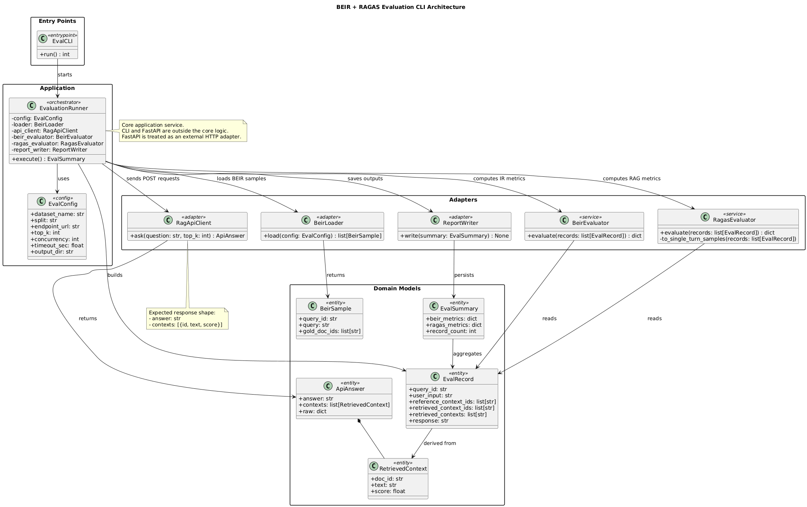

# Edge RAG Evaluator

BEIR 기반 평가와 RAGAS 점수를 계산하는 CLI 모듈입니다.

CLI module that evaluates BEIR retrieval and computes RAGAS metrics.

---
## 개요 / Overview
- 외부 서버에 질문을 POST로 전송합니다.
- 응답을 기반으로 BEIR / RAGAS 평가를 실행합니다.
- 결과를 JSON/Markdown으로 저장할 수 있습니다.


- Sends questions to an external server via POST.
- Runs BEIR / RAGAS evaluation from the responses.
- Persists results as JSON/Markdown.

---
## 설치 / Installation
```bash
uv sync
```

---
## 사용법 / Usage
```bash
uv run main.py \
  --dataset scifact \
  --base-url http://localhost:8000 \
  --advanced hyde \
  --output reports/scifact-hyde.json \
  --ragas-metric Faithfulness \
  --ragas-metric ResponseRelevancy
```

전체 Advanced RAG 모드를 동일한 query 집합으로 순차 평가하려면 고수준
실험 스크립트를 사용합니다. Edge latency 비교의 기본값은 동시성 1입니다.

```bash
uv run python scripts/run_experiment.py \
  --dataset scifact \
  --data-dir /home/jaehun/playground/edge-rag-experiments/data/beir \
  --base-url http://192.168.0.82:8000 \
  --output-dir reports/scifact-all
```

smoke run은 `--limit`, 일부 모드만 실행할 때는 반복 가능한 `--mode`를
사용합니다.

```bash
uv run python scripts/run_experiment.py \
  --dataset scifact \
  --data-dir /home/jaehun/playground/edge-rag-experiments/data/beir \
  --base-url http://192.168.0.82:8000 \
  --mode none \
  --mode hyde \
  --limit 5 \
  --dry-run
```

각 모드의 JSON에는 query별 response, retrieved document/chunk, BEIR reference,
서버 `trace`가 저장됩니다. `manifest.json`에는 실행 모드, evaluator commit,
성공 여부와 로그 경로가 기록됩니다.

---
## GitHub Actions Automation
- `CI and Deploy`: `push`/`pull_request`마다 테스트를 실행하고, `master`/`main` push 시 VM에 최신 코드를 반영합니다.
- `Run Evaluation`: GitHub Actions의 `workflow_dispatch` 버튼으로 평가를 수동 실행합니다.
  여러 advanced mode를 한 번에 실행하고 결과를 workflow artifact로 저장합니다.

### GitHub Secrets
- `VM_HOST`: Compute Engine external IP or hostname
- `VM_USER`: SSH login user
- `VM_SSH_KEY`: private key for a deploy key that can SSH into the VM

### GitHub Variables
- `VM_APP_DIR`: optional, defaults to `/home/<VM_USER>/edge_rag_server`
- `VM_SSH_PORT`: optional, defaults to `22`

### VM Setup
```bash
ssh-keygen -t ed25519 -f ~/.ssh/github_actions_vm -C "github-actions"
cat ~/.ssh/github_actions_vm.pub >> ~/.ssh/authorized_keys
git clone <YOUR_GITHUB_REPO_URL> ~/edge_rag_server
cd ~/edge_rag_server
~/.local/bin/uv sync --frozen
```

Save the contents of `~/.ssh/github_actions_vm` as the GitHub secret `VM_SSH_KEY`.

After that, code deployment is automatic on `push`, while evaluation remains a manual GitHub Actions run.
---
## 아키텍처 / Architecture
UML 다이어그램: `UML/evaluation_architecture.puml`

---
### 다이어그램 이미지 / Diagram Image


---
## 요청/응답 스키마 / Request/Response Schema

이 모듈은 외부 서버로 단일 POST 요청을 보냅니다.

The module sends a single POST request to an external server.


서버는 아래 요청을 받아 내부 RAG IO 계약으로 변환하고, 단일 실행 응답을 반환해야 합니다.
기존 `{ "answer": ..., "contexts": ... }` 응답도 하위 호환으로 읽습니다.

The server should convert this request into the internal RAG IO contract and return
a single-run response. The legacy `{ "answer": ..., "contexts": ... }` response is
still accepted.

### Request (JSON)
```json
{
  "question": "string",
  "dataset": "scifact",
  "split": "test",
  "sample_id": "query-id",
  "advanced": "hyde"
}
```

### Response (JSON)
```json
{
  "status": "ok",
  "mode": "naive_rag",
  "answer": "string",
  "retrieved_contexts": [
    {
      "rank": 1,
      "doc_id": "doc_id",
      "chunk_id": 42,
      "text": "context chunk",
      "score": 0.91
    }
  ],
  "trace": {}
}
```
